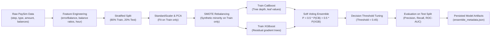
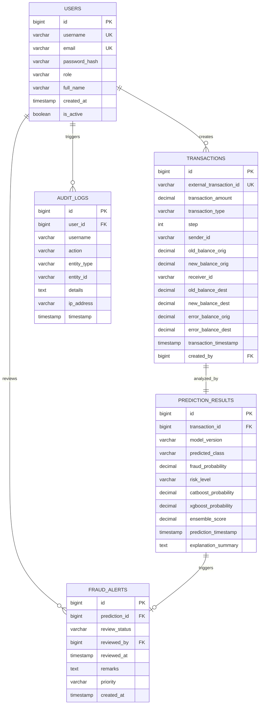

# AI-Based Online Payment Fraud Detection System Using Ensemble Machine Learning

[](https://spring.io/projects/spring-boot)
[](https://openjdk.org/)
[](https://www.python.org/)
[](https://flask.palletsprojects.com/)
[](https://www.mysql.com/)
[](LICENSE)

An enterprise-grade, full-stack financial fraud detection web platform designed for final-year engineering projects. Integrates **CatBoost**, **XGBoost**, and a **Soft Voting Ensemble** with **SMOTE** class rebalancing and **PCA** dimensionality reduction to detect fraudulent transactions in real time with probabilistic risk scores, explainability, and full compliance audit trails.

---

## 1. System Architecture

```mermaid
flowchart TD
    subgraph Client ["Frontend Presentation Layer (HTML5, CSS3, JS, Chart.js)"]
        UI["Responsive Dashboard UI (Port 8080)"]
        SingleForm["Single Transaction Form"]
        BatchUpload["CSV Batch Upload"]
        HistoryView["Transaction History Explorer"]
        AlertsView["Fraud Alerts & Review"]
        AdminView["Admin & Model Metrics"]
    end

    subgraph Backend ["Backend Processing Layer (Java 21 / Spring Boot 3.x)"]
        Security["Spring Security 6 + BCrypt + JWT Filter"]
        Controllers["REST Controllers (/api/*)"]
        ServiceLayer["Transaction & Dashboard Services"]
        AuditService["Security Audit Logging Engine"]
        MlClient["ML Microservice REST Client (RestTemplate)"]
    end

    subgraph MLService ["Machine Learning Engine (Python Flask / FastAPI)"]
        Engine["Ensemble Inference Engine (/predict, /batch-predict)"]
        CatBoost["CatBoost Classifier"]
        XGBoost["XGBoost Classifier"]
        VotingEnsemble["Soft Voting Probability Combiner"]
        Preproc["Preprocessing (SMOTE + PCA + StandardScaler)"]
    end

    subgraph DatabaseLayer ["Persistence Layer (MySQL 8.x / Embedded H2)"]
        UsersTable[("users")]
        TxnTable[("transactions")]
        PredTable[("prediction_results")]
        AlertsTable[("fraud_alerts")]
        AuditTable[("audit_logs")]
    end

    UI -->|HTTP / JSON + JWT| Controllers
    SingleForm -->|POST /api/transactions/predict| Controllers
    BatchUpload -->|POST /api/transactions/batch-predict| Controllers
    HistoryView -->|GET /api/transactions| Controllers
    AlertsView -->|PATCH /api/alerts/{id}/status| Controllers
    AdminView -->|GET /api/admin/*| Controllers

    Controllers --> Security
    Security --> ServiceLayer
    ServiceLayer --> AuditService
    ServiceLayer --> MlClient
    MlClient -->|REST HTTP / Port 5001| Engine
    Engine --> Preproc
    Preproc --> CatBoost
    Preproc --> XGBoost
    CatBoost --> VotingEnsemble
    XGBoost --> VotingEnsemble
    VotingEnsemble -->|Class, Probability, Explanation| MlClient

    ServiceLayer --> DatabaseLayer
    AuditService --> AuditTable
```

---

## 2. Machine Learning Workflow



---

## 3. Database Entity-Relationship (ER) Diagram



---

## 4. Technology Stack & Key Highlights

| Component | Technology | Role & Purpose |
| :--- | :--- | :--- |
| **Frontend** | HTML5, CSS3, Vanilla JS, Chart.js | Modern responsive financial dashboard, risk dials, multi-tab routing, CSV drag-and-drop |
| **Backend** | Java 21 / Spring Boot 3.2.4 | Enterprise REST APIs, Spring Security 6, JWT, JPA / Hibernate, Audit Logging |
| **Database** | MySQL 8.x / Embedded H2 | Dual configuration: Instant embedded local mode or production MySQL 8.x |
| **ML Models** | CatBoost, XGBoost, Soft Voting Ensemble | Probability combination, decision threshold optimization, balance anomaly detection |
| **Imbalance** | SMOTE (Synthetic Minority Over-sampling) | Resamples rare fraud events strictly on the training partition without data leakage |
| **Dimensionality** | Principal Component Analysis (PCA) | Extracts principal variance components PC1 and PC2 from collinear account balances |
| **Microservice** | Python 3.11+ Flask / FastAPI | High-speed REST microservice for real-time inference (< 1ms per prediction) |
| **API Docs** | Springdoc OpenAPI 3.0 / Swagger UI | Interactive API documentation at `/swagger-ui.html` |
| **DevOps** | Docker, Docker Compose, Maven | Multi-container automated orchestration and isolated builds |

---

## 5. Execution Instructions (Step-by-Step)

### Prerequisites
- **Python**: 3.10, 3.11, 3.12, 3.13 or 3.14
- **Java**: JDK 17, 21, or 25
- **Maven**: 3.8+ (or use included `mvnw.cmd` / `mvnw`)
- **MySQL**: 8.x (Optional: The application defaults to zero-config embedded H2 if MySQL is not running)

---

### Terminal 1: Start the Machine Learning Microservice
```powershell
# 1. Navigate to the ML service folder
cd ml_service

# 2. (Optional) Create and activate virtual environment
python -m venv venv
.\venv\Scripts\Activate.ps1

# 3. Install dependencies
pip install -r requirements.txt

# 4. Generate dataset and train the ensemble models
python train_models.py

# 5. Verify benchmark metrics
python evaluate.py

# 6. Start the Flask ML REST Microservice
python app.py
```
> The ML microservice will start on `http://localhost:5001`.
> Endpoints:
> - `GET  http://localhost:5001/health`
> - `POST http://localhost:5001/predict`
> - `POST http://localhost:5001/batch-predict`
> - `GET  http://localhost:5001/model-metrics`

---

### Terminal 2: Start the Java Spring Boot Backend
```powershell
# 1. Navigate to the backend folder
cd backend

# 2. Build and run Spring Boot
# Using standard Maven:
mvn clean spring-boot:run

# Or with MySQL 8.x active:
mvn spring-boot:run -Dspring-boot.run.profiles=mysql
```
> The Spring Boot application starts on `http://localhost:8080`.
> - **Frontend Web Dashboard**: Open `http://localhost:8080` in your browser.
> - **Swagger API Documentation**: Open `http://localhost:8080/swagger-ui.html`.

---

### Terminal 3 (Alternative): Docker Compose All-In-One Launch
```powershell
docker-compose up --build
```
> Automatically spins up MySQL 8.0, the Python ML microservice, and Spring Boot.

---

## 6. Default Demo Credentials

| Role | Username | Password | Privileges |
| :--- | :--- | :--- | :--- |
| **Administrator** | `admin` | `Admin@123` | Full dashboard, single & batch predictions, fraud alert status review, user management, audit logs, model metrics |
| **Risk Analyst** | `analyst` | `Analyst@123` | Dashboard, single & batch fraud detection, transaction history search |

---

## 7. Sample API Requests & Responses

### A. Predict Single Transaction
**Request:**
`POST http://localhost:8080/api/transactions/predict`
```json
{
  "type": "TRANSFER",
  "amount": 98500.00,
  "step": 14,
  "senderId": "C8492031920",
  "oldbalanceOrg": 98500.00,
  "newbalanceOrig": 0.00,
  "receiverId": "C9918237192",
  "oldbalanceDest": 0.00,
  "newbalanceDest": 0.00
}
```

**Response (`201 Created`):**
```json
{
  "transactionId": 8,
  "externalTransactionId": "TXN-1729683921-4F2A9B10",
  "predictedClass": "FRAUD",
  "fraudProbability": 0.9420,
  "riskLevel": "HIGH",
  "catboostProbability": 0.9380,
  "xgboostProbability": 0.9460,
  "ensembleScore": 0.9420,
  "modelVersion": "v1.0-ensemble",
  "explanationSummary": "High-risk transaction pattern 'TRANSFER' commonly exploited in account takeover. | Full source balance exhaustion (100% liquidation) detected. | Recipient balance discrepancy: Funds left sender but destination shows zero balance.",
  "predictionTimestamp": "2026-10-23T17:15:30",
  "disclaimer": "Notice: This prediction is a probabilistic risk estimate generated by an ensemble machine learning model and should serve as an analytical aid rather than an automated transaction rejection."
}
```

---

## 8. Troubleshooting Guide

| Issue | Cause | Solution |
| :--- | :--- | :--- |
| `Connection refused: localhost:5001` | ML service not running | Start `python ml_service/app.py` in Terminal 1 first. |
| `Access denied for user 'root'@'localhost'` | MySQL credentials mismatch | Verify credentials in `application-mysql.yml` or use the default embedded H2 database. |
| `Port 8080 already in use` | Another process on 8080 | Change `server.port` in `backend/src/main/resources/application.yml` or kill the occupying PID. |
| `File too large error` on batch upload | File exceeds 10MB | Upload smaller CSV batches or increase `spring.servlet.multipart.max-file-size`. |
